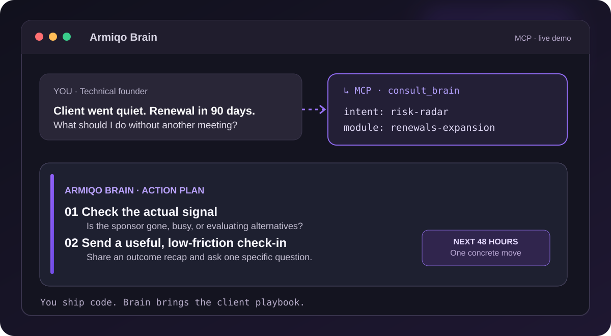

# Armiqo Brain

[](https://mcptry.com/servers/io.github.matt-warchol/armiqo-brain)

**You ship code. Your clients still expect account management.**

A free, read-only MCP playbook for the developer, tech lead or agency founder who would rather debug a production incident than prepare another QBR.

**No new dashboard. No account to create. No CRM migration.** Add one MCP URL to a compatible AI assistant and ask about the client situation you're dealing with.

[**Connect the Brain**](https://armiqo.com/brain/) · [**Try the remote MCP endpoint**](https://armiqo.com/mcp/) · [**Report an issue**](https://github.com/matt-warchol/armiqo-brain/issues)



> **The pitch:** You know how to build and ship. Keeping clients happy, preparing for awkward calls, spotting churn risk and growing an account? That's a different skill tree. Brain gives your AI assistant a practical B2B account-management playbook, so you don't have to start from a blank page.

## The bugs it helps with (that aren't in your code)

| Situation | Ask Brain |
| --- | --- |
| Client suddenly went silent | "Renewal in 90 days and our sponsor stopped replying. What are the warning signs and next 48-hour moves?" |
| QBR tomorrow, zero prep | "Build a QBR outline around outcomes, risks, and next-quarter decisions." |
| Scope creep in the sprint | "The client wants two extra features by Friday. Help me frame the tradeoffs." |
| Rate increase feels awkward | "How should I approach an 8% rate increase with a long-term agency client?" |
| Relationship depends on one person | "Our champion left. Who should we map and approach next?" |
| Account is healthy but static | "Give me low-pressure ways to discover expansion opportunities." |

This is **advice, not automation**. The Brain doesn't see your CRM, send emails or monitor clients autonomously. You remain in control of what you share and what action to take.

## Quick start: one URL

```text
https://armiqo.com/mcp/
```

Add this URL as a **remote Streamable HTTP MCP server** in your MCP-compatible AI client, then try:

```text
Use Armiqo Brain. Our client went quiet after a new VP joined.
Renewal is in 90 days. What should we do this week?
```

The setup UI depends on your AI client and plan. [Open the website for connection guidance](https://armiqo.com/brain/).

### What actually happens?

```text
You (in your AI assistant)
  └─ ask about client risk, QBR, renewal, scope or growth
      └─ consult_brain(question)
          └─ relevant playbook modules
              └─ assistant suggests a next step you can take
```

The MCP server returns *knowledge and frameworks*. Your assistant works with your supplied context to produce the response. It doesn't automatically generate or send actual PDFs, calendar events, outreach or status reports.

## Available MCP tools

| Tool | Result |
| --- | --- |
| `consult_brain` | Picks relevant modules for your client question |
| `list_modules` | Lists the available playbook categories |
| `get_module` | Returns a specific account-management playbook module |

Topics include account plans, churn risk, renewals, growth, stakeholder maps, meeting prep, portfolio health, difficult conversations, and email templates.

## Built for builders, not career account managers

- **If you're a solo founder:** Get a second brain for customer retention without hiring an account manager.
- **If you're a tech lead:** Turn uncomfortable commercial conversations into a clearer set of options.
- **If you're running a dev agency:** Give delivery teams a practical framework for client relationships, without forcing them into a full CRM.
- **If you already have an AM:** Use the Brain as a checklist or meeting-prep reference, not a replacement for judgment.

The public free Brain is the playbook. [Armiqo](https://armiqo.com/) is the separate product intended to help run post-sale processes with real client context.

## Privacy and ownership

The hosted service can receive questions forwarded by your AI client. Avoid sharing passwords, customer secrets or personal data in prompts. Usage telemetry may capture pseudonymous IDs, tool names, inferred topic, error codes and latency, **not the raw prompt or response body**.

**This is the public documentation and Registry metadata repository for a hosted MCP, not the server's source code.** The implementation and full playbook library remain private. The repository MIT license applies to the files published here, not to unpublished source code or proprietary knowledge.

- [Security policy](SECURITY.md)
- [Registry manifest](server.json)
- [MCP Registry listing](https://registry.modelcontextprotocol.io/)
- [mcptry live status](https://mcptry.com/servers/io.github.matt-warchol/armiqo-brain)

## A useful question beats another dashboard

Start with the client you least want to call this week. Ask the Brain what to do next.

**[Connect Armiqo Brain →](https://armiqo.com/brain/)**
